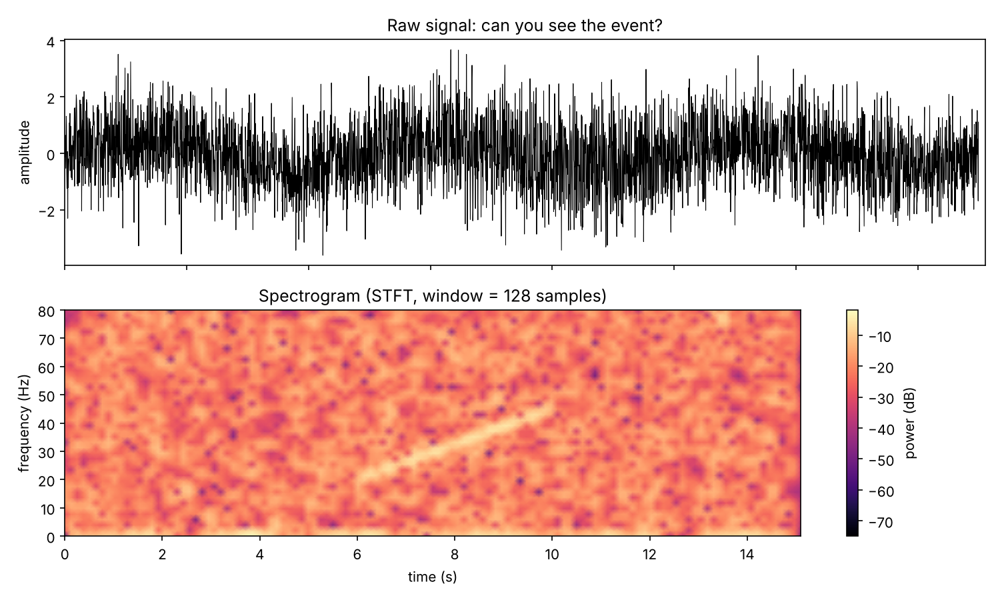

# Signal to spectrogram

A noisy 15 s signal (250 Hz) hides a weak sweep from 20 to 45 Hz between 6 and 10 s. In the raw trace you can't see it. After a short-time Fourier transform it shows up as a diagonal line.

Once a signal is an image, the usual computer vision tools (CNNs, segmentation, feature extraction) become available. That's why EEG, audio and vibration data are so often classified with image models.

Things worth checking:
- Window length and overlap decide what is visible at all. Try `nperseg = 32` and `512`.
- When you train on spectrograms, split by recording or subject, never by time slice.

