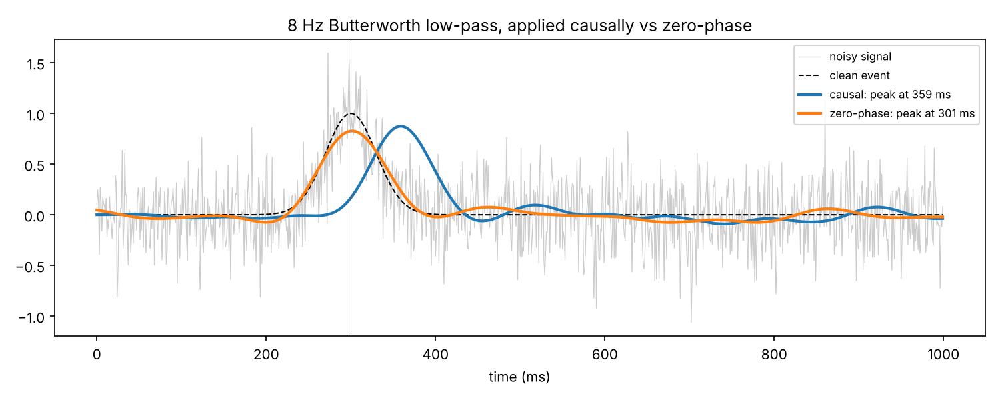

# Filter phase delay

A clean event peaks at 300 ms. Add noise, then apply the same 4th-order 8 Hz Butterworth low-pass in two ways:

| Method | Peak |
|---|---|
| true | 300 ms |
| causal, `scipy.signal.lfilter` | 359 ms |
| zero-phase, `scipy.signal.filtfilt` | 301 ms |

A causal filter only looks backwards, so it delays the signal. For EEG or ECG, where timing carries the meaning, that matters. Zero-phase filtering uses future samples, which is fine offline but impossible in a real-time system. Pick one on purpose, and use the same one in training and deployment.

