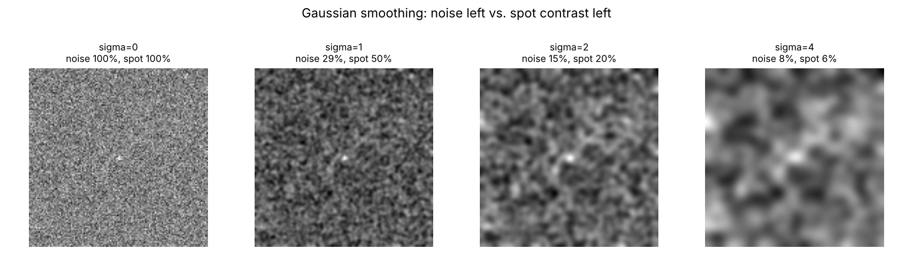

# Smoothing vs small structures

A 128 x 128 image with Gaussian noise and one tiny bright spot, blurred with increasing sigma:

| sigma | noise left | spot peak left |
|---|---|---|
| 0 | 100 % | 100 % |
| 1 | 29 % | 50 % |
| 2 | 15 % | 20 % |
| 4 | 8 % | 6 % |

The image looks cleaner every step, but the structure you might care about fades faster than the noise. Check what a filter does to the target, not just to the background, and start with the lightest smoothing that works.

