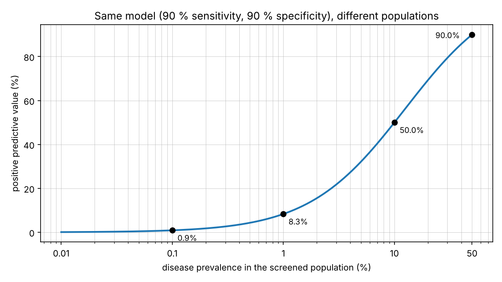

# Screening and positive predictive value

A classifier with 90 % sensitivity and 90 % specificity sounds "90 % accurate". Use it to screen 1,000 people where 1 % have the disease:

| | Count |
|---|---|
| sick | 10 |
| sick and flagged | 9 |
| healthy but flagged | 99 |
| flagged in total | 108 |

Only 9 of the 108 flagged people are really sick, so the positive predictive value (PPV) is about 8 %.

The same model in other populations (exact value, and a simulation with 1,000,000 people each):

| Prevalence | PPV (exact) | PPV (simulated) |
|---|---|---|
| 50 % | 90.0 % | 90.0 % |
| 10 % | 50.0 % | 50.1 % |
| 1 % | 8.3 % | 8.3 % |
| 0.1 % | 0.9 % | 0.9 % |

The model did not change. The population did. In screening, where most people are healthy, report sensitivity, specificity and PPV together with the prevalence, evaluate on data that looks like the real deployment, and decide what a false alarm costs before choosing a threshold.

