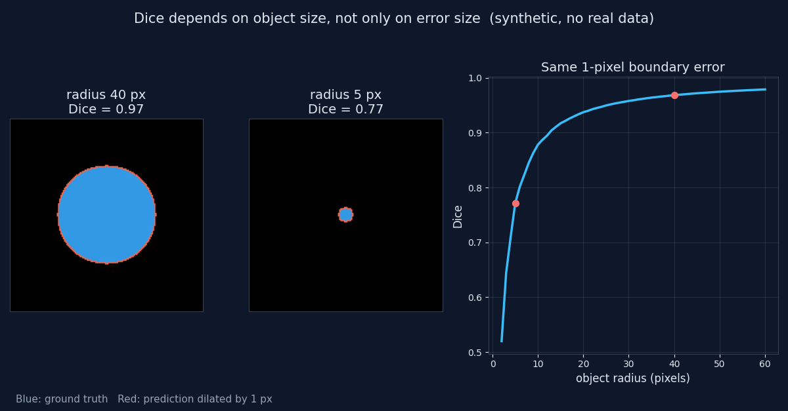

# 14 - Dice vs object size

The same 1-pixel boundary error gives very different Dice scores depending on how big the object is. Synthetic data only, nothing here is clinical.

A circular "lesion" is the ground truth, and the prediction is the same mask dilated by one pixel. Only the radius changes.

| Radius (px) | Dice |
|---|---|
| 3 | 0.64 |
| 5 | 0.77 |
| 10 | 0.88 |
| 20 | 0.94 |
| 40 | 0.97 |

Small structures are the most sensitive, because their boundary is a large share of their area. Report Dice per size range, and add a detection metric and a boundary metric next to it.

```bash
python dice_vs_object_size.py
```


